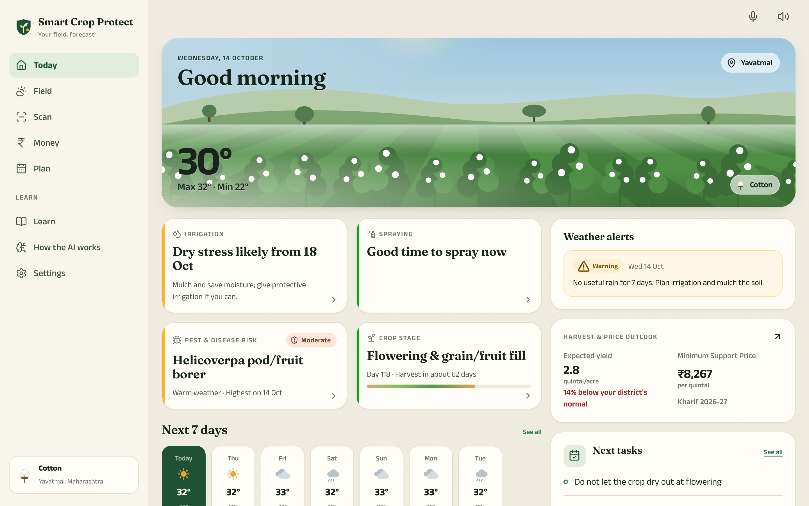
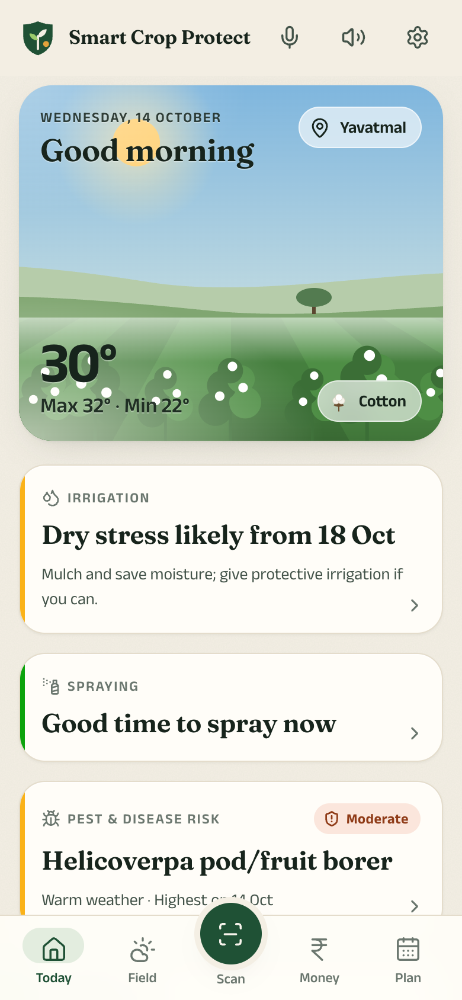
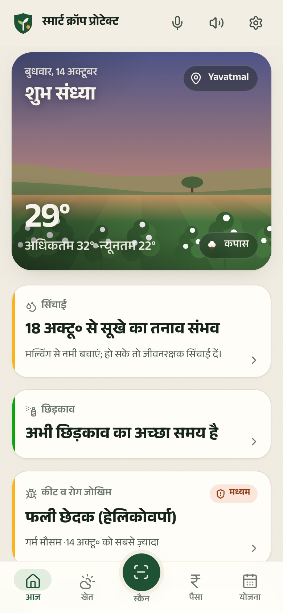
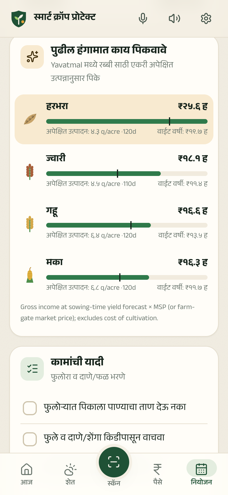
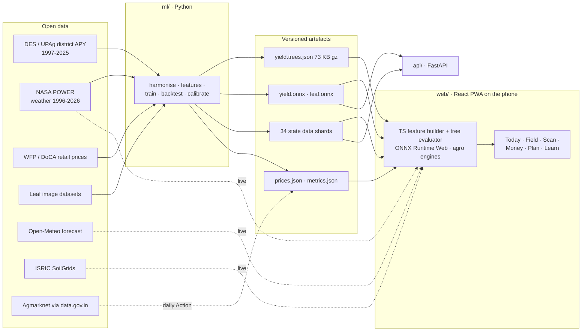
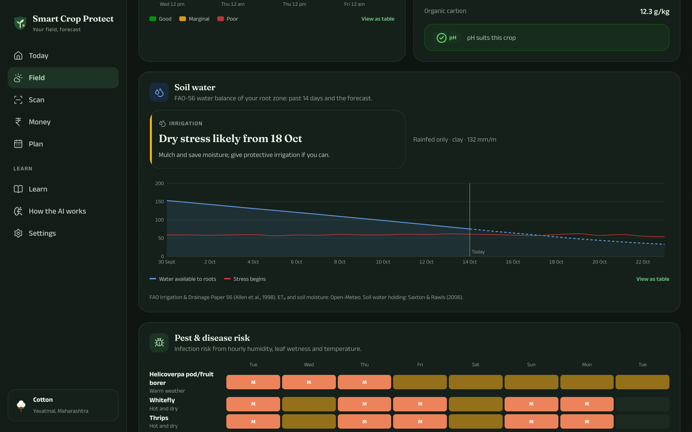

<div align="center">


# Smart Crop Protect

**An on-device AI field assistant for Indian farmers: crop doctor, weather and water advisor,
district yield forecasts and market outlooks, in English, हिन्दी, मराठी and ગુજરાતી.**

[**Open the live app →**](https://samarth731.github.io/smart-crop-protect/?demo) &nbsp;·&nbsp;
[How the AI works](https://samarth731.github.io/smart-crop-protect/ai) &nbsp;·&nbsp;
[Model cards](docs/model-cards.md)

[](https://github.com/Samarth731/smart-crop-protect/actions/workflows/ci.yml)
[](https://github.com/Samarth731/smart-crop-protect/actions/workflows/deploy.yml)




</div>

---

## Why

Smallholder farmers lose yield to things that are predictable a few days or weeks ahead:
a dry spell at flowering, a humid week that sets off blight, a spray washed off by rain, or a
harvest sold the month prices bottom out. The information exists, but it is scattered across
government portals, satellite products and research papers, and rarely in the farmer's language.

Smart Crop Protect turns that information into **one plain-language verdict per decision** for
*your* field, and every model behind those verdicts is trained on public Indian data, tested on
years it never saw, and **runs on the phone**, so it works offline and nothing about the farm
leaves the device.

<table>
<tr>
<td width="33%"></td>
<td width="33%"></td>
<td width="33%"></td>
</tr>
<tr>
<td align="center"><sub>Today: four verdicts and the week ahead</sub></td>
<td align="center"><sub>हिन्दी: every screen in four languages</sub></td>
<td align="center"><sub>मराठी: next-season crop advisor</sub></td>
</tr>
</table>

## What it does

| | |
|---|---|
| **Today** | A living illustration of your field (real local time, live weather, your crop at its actual growth stage) and four verdicts: *irrigate or not*, *best spray window*, *top pest/disease risk*, *crop stage*. IMD-threshold weather alerts. |
| **Field** | 10-day forecast, an hour-by-hour **spray planner** (rain, wind, heat, Delta-T), an **FAO-56 soil-water balance** seeded from satellite-model soil moisture and your SoilGrids soil, and a 7-day **pest & disease risk** heat-map from published infection models. |
| **Crop doctor** | Photograph a leaf: an on-device **CNN** names the disease and a colour-segmentation model measures **% of leaf area damaged**. Or tick symptoms for a **naive-Bayes expert system** that knows this week's weather. |
| **Harvest & money** | A **district yield forecast** with an 80% range that sharpens as the season's weather comes in, *what-if* dry/normal/wet scenarios, income at MSP, a **6-month price outlook** for your price zone, and live mandi rates. |
| **Plan** | FAO-56 crop timeline, stage-aware checklist, and a **next-season crop advisor** ranking crops by expected income per acre in your district. |
| **Learn** | 45 pests, diseases and stresses across 17 crops, with organic, cultural and chemical options. |

Works as an installable **PWA**, fully **offline** after first use, with voice navigation and read-aloud in all four languages.

## The machine learning

All numbers below are on **held-out future years**: models are fitted on earlier years only.

### 1 · District yield forecaster
`scikit-learn HistGradientBoostingRegressor` · 494,396 training rows · 16 crops · 700+ districts · 1999–2024

| Test 2020–24, full season | Model | District normal | Trend line |
|---|---|---|---|
| Median absolute % error | **13.7 %** | 14.7 % | 18.4 % |
| Skill (MAE, log scale) | **+10.3 %** vs normal | | +26 % vs trend |
| 80 % interval coverage | **84 %** (split-conformal, per crop × stage) | | |

Skill by crop ranges from **+29 % for cotton**, +14 % bajra and +13 % rice, maize and groundnut
(rainfed crops, where weather matters) down to +1 % for irrigated wheat, whose normal is already stable.

**What made it work.** The first version was no better than the baseline once weather was added, so I
investigated instead of shipping it:

* National-level yields correlate strongly with monsoon rain (*r* = 0.63) and soil moisture (*r* = 0.70),
  but **within a year, district yield anomalies are mostly sampling noise** from crop-cutting surveys
  (*r* ≈ 0.01–0.05 with weather).
* Ratio rainfall anomalies are right-skewed and drifted with the wet 2019–24 monsoons. **Symmetric
  log-ratio** anomalies fixed it.
* An **ablation** (no weather / district / state anchors / both) picked district-level weather;
  **interaction constraints** that forbade weather×state splits made it *worse*, which shows that weather
  effects genuinely differ between irrigated Punjab and rainfed Vidarbha.
* The baseline is **lagged two years**, matching when DES statistics are actually published, and training
  rows are **replicated at sowing, ⅓, ⅔ and full season** with unseen months set to climatology, so one model
  forecasts in-season.
* Data fixes found along the way: APY cotton is reported in bales (×170 kg) under a "Tonnes" label; rice is
  milled rice (paddy = ÷ 0.67); Bengal's *aus*/*aman* sub-seasons are folded into kharif.

### 2 · Market price forecaster
Global quantile gradient boosting over ~1,700 market × commodity series (WFP / Dept. of Consumer Affairs, 1994–2026)

| Price-zone forecasts, origins 2022–26 | 1 month | 3 months | 6 months |
|---|---|---|---|
| Model MAPE | **2.7 %** | **5.5 %** | **9.9 %** |
| Naive (no change) | 3.2 % | 6.6 % | 13.0 % |
| Seasonal naive | 4.9 % | 10.2 % | 18.3 % |
| 80 % interval coverage | 88 % | 93 % | 88 % |

Intervals are calibrated with **conformalized quantile regression**; smooth zone averages get a learned
blend with *no change* (weight 0.25 at 1 month → 1.0 at 6 months). The source repeats stale values when a
month is not updated; those carry-forwards are detected and removed. Retail prices are converted to
farm-gate with the RBI (2024) farmers' share of the consumer rupee where no MSP exists.

### 3 · Leaf disease classifier
MobileNetV3 fine-tuned with PyTorch on Indian rice, cotton and groundnut leaf datasets plus PlantVillage
(maize, potato, tomato, pepper), exported to ONNX and run in the browser. Evaluated on held-out images **and on
real field photos (PlantDoc)**. See the [model card](docs/model-cards.md#leaf-disease-classifier).

### Agronomic engines (physics and published plant pathology, not black boxes)
* **Irrigation**: FAO-56 single crop-coefficient curves by growth stage, SCS curve-number runoff, water-stress coefficient,
  Saxton & Rawls (2006) soil hydraulics from ISRIC SoilGrids texture, AWD advice for paddy.
* **Disease risk**: Hutton criteria (late blight), Jensen–Boyle (groundnut leaf spot), and leaf-wetness ×
  temperature windows for rusts, blast and blights, run on hourly forecasts.
* **Spraying**: rain-free time, boom-height wind and Delta-T (Stull 2011 wet-bulb).

## Architecture



**Three implementations, one truth.** The yield features exist in Python (training), TypeScript (browser) and
numpy (API). All three are tested against the same 40 golden cases exported from the pipeline, and the browser's
tree evaluator matches scikit-learn to 1e-5. In the browser the model is a 73 KB tree file instead of a 14 MB
ONNX runtime, which matters on rural 3G.

## Repository

```
ml/        data pipelines, feature engineering, training, evaluation, ONNX/JSON export   (Python, uv)
web/       the PWA: design system, charts, i18n, agro engines, on-device ML              (React 19, TS, Vite)
api/       model-serving API with parity tests                                             (FastAPI)
docs/      model cards and screenshots
.github/   CI · GitHub Pages deploy · scheduled market-data refresh
```

## Run it

```bash
make setup     # Python (uv) + Node dependencies
make dev       # web app at http://localhost:5173/smart-crop-protect/?demo
make test      # ml + api + web test suites
```

Rebuild everything from the raw data:

```bash
make data      # download APY/UPAG, WFP, GeoNames; geocode 752 districts; fetch NASA POWER
make train     # yield + price models, evaluation reports
make export    # web data shards, golden fixtures, model-card metrics
make train-leaf  # optional: leaf CNN (PyTorch, ~45 min on an M1)
```

Model API: `make api`, then `POST /v1/yield/forecast {"district_code": 500, "crop": "cotton"}`.

**Live mandi prices.** Add a free [data.gov.in API key](https://data.gov.in/user/register) as the repository
secret `DATA_GOV_IN_API_KEY`; the *Refresh market data* workflow then publishes Agmarknet prices daily and the
app shows them automatically.

## Design

A warm "monsoon paper" palette with a deep night-field dark theme, Fraunces for English display type and the
Anek family (one design across Latin, Devanagari and Gujarati) for everything else. Indic fonts load only
when that language is chosen. The chart palette is validated for colour-vision deficiency in both themes;
status is never colour alone (icon + label); every chart has a table view and keyboard tooltips; touch targets
are at least 48 px; text can be enlarged; motion respects `prefers-reduced-motion`.



## Data & licences

| Data | Source | Licence |
|---|---|---|
| District crop area, production & yield | DES & UPAg, Ministry of Agriculture & Farmers Welfare, via India Data Portal | ODC-By |
| Weather 1996–2026 | NASA POWER (MERRA-2 / CERES) | Public domain |
| Forecasts, soil moisture, leaf wetness | Open-Meteo | CC BY 4.0 |
| Soil properties (250 m) | ISRIC SoilGrids 2.0 | CC BY 4.0 |
| Retail food prices | WFP VAM / Dept. of Consumer Affairs, via HDX | CC BY-IGO |
| Minimum Support Prices 2026-27 / 2027-28 | CCEA, Government of India | Public |
| District gazetteer | GeoNames | CC BY 4.0 |
| Leaf images | Project-AgML (UC Davis) mirrors of PlantVillage, Indian rice, cotton and groundnut sets; PlantDoc | CC BY / CC BY-SA / CC BY-NC |

## Responsible use

Forecasts are district averages with honest uncertainty; a single field can do much better or worse. Pest
advice names active ingredients only and always defers to the product label and the local Krishi Vigyan
Kendra. The leaf classifier abstains when unsure.

## Licence

Code: MIT. Data and derived artefacts keep their original licences (above).
